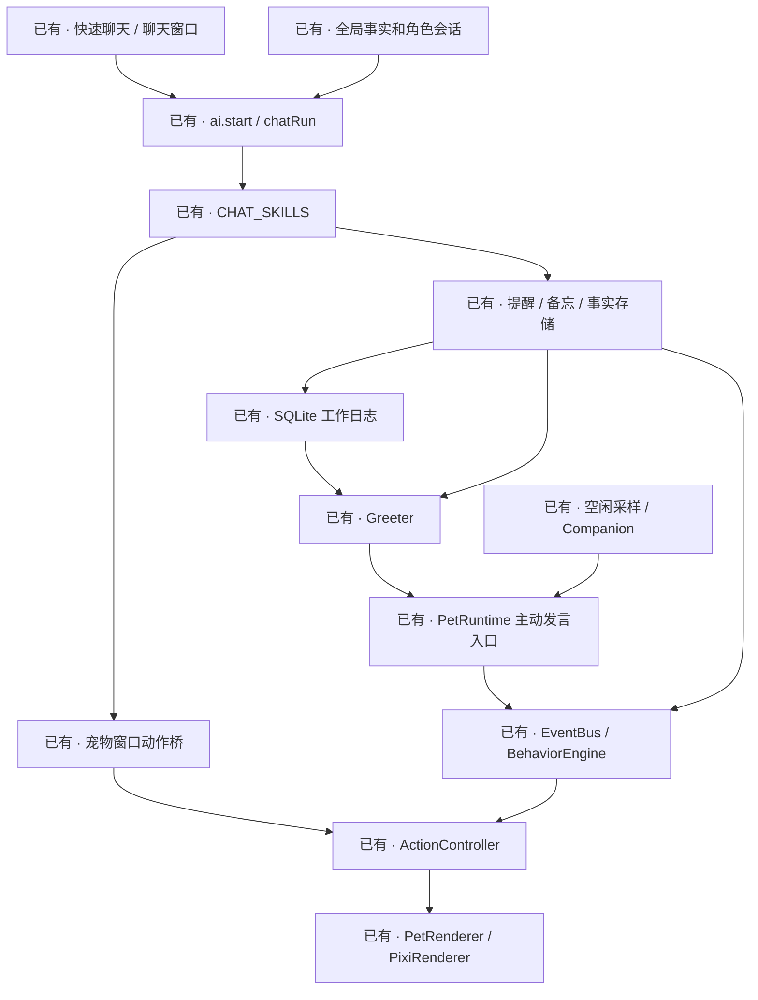
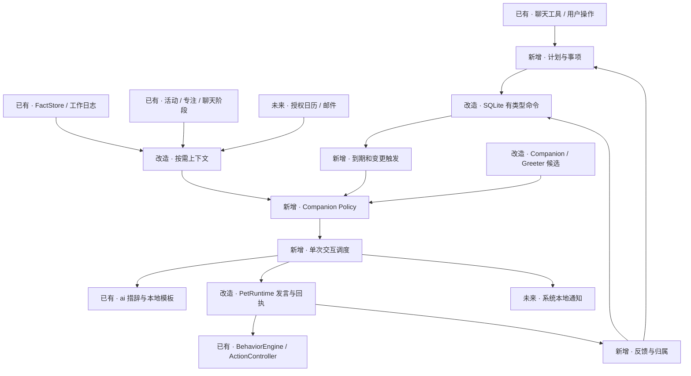
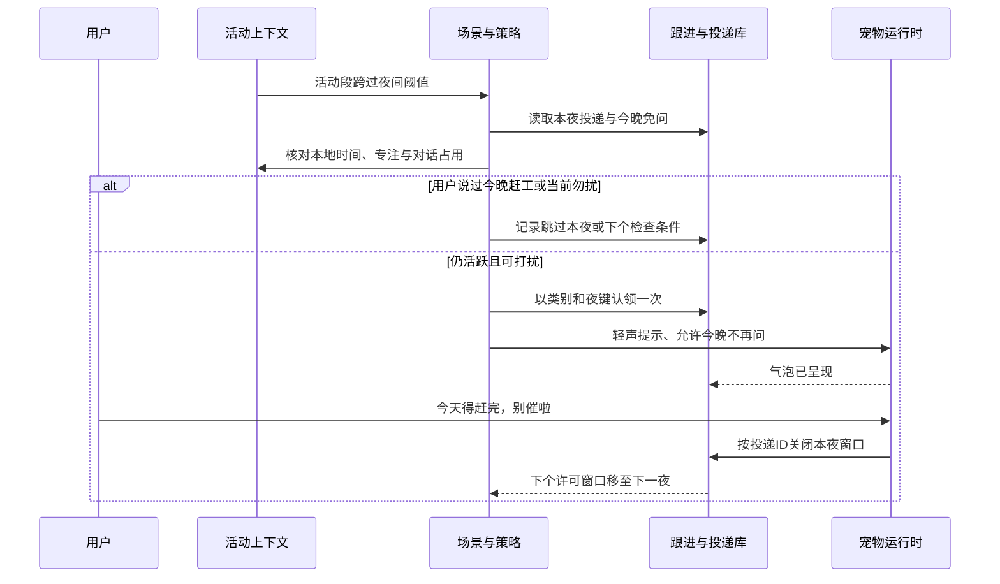
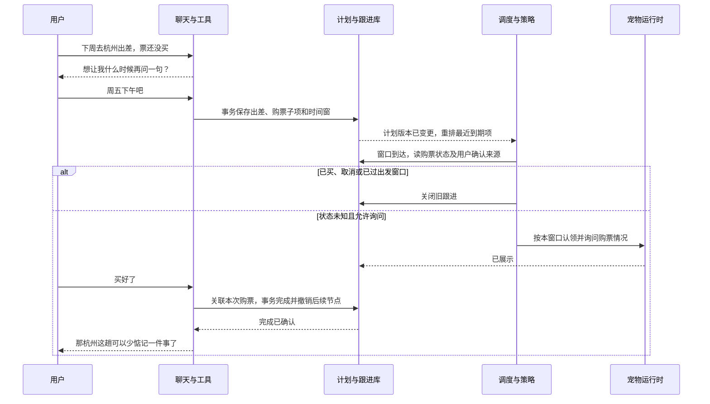
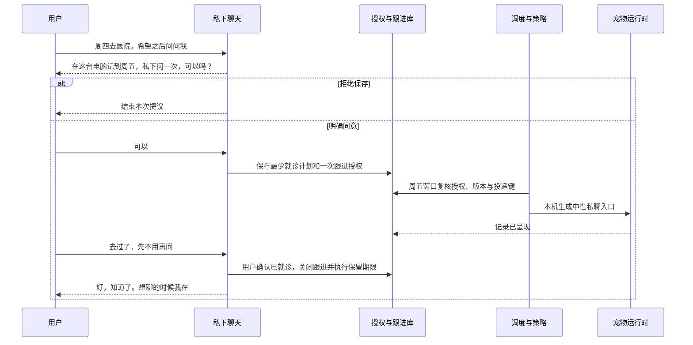
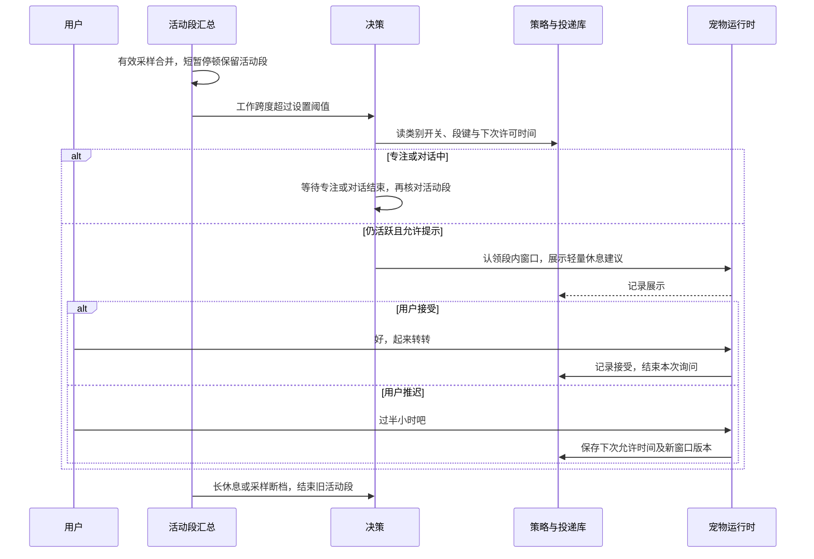

# 主动陪伴系统架构评审

2026-11-19 · desk-ai-pet · 第一阶段设计稿  
审查对象为 HEAD `237322c` 加当时工作区中的未提交改动。下文路径相对仓库根目录。结论来自源码、配置与测试用例的静态追踪。没有读取个人聊天、诊断库或使用统计，没有运行付费模型、安装包或负载测试。时间间隔若标为“建议”，属于待验收的产品参数。

## 评审决定

**建议引入一个本地的 Proactive Companion Engine，第一刀落在“发言前做决定”，第二刀落在“问过的事情能收尾”。** 用户上周说“杭州的票还没买”，今天说“买好了”，理想结果是宠物能接一句“那下周出发就踏实了”，明天安静。要做到这点，需要知道“哪一趟出差、哪件事、是谁确认了完成”，并撤销未来的询问。增加记忆数量、更多动作或更长提示词，都无法独立完成这个闭环。

保留 Agent 的工具循环、角色包、动作控制器、明确提醒和现有存储。新引擎是主窗口装配的一组领域函数和一个持久化调度入口。Rust 提供有类型的本机命令和事务。首个可验收切片选“今晚别催我”和“聊天时别插话”，随后用购票验证跨天闭环。就诊关心排在授权、删除和恢复机制之后。

## 一、今天实际怎样工作



| 范围 | 实际入口、调用链和数据 | 边界与诊断 |
|---|---|---|
| 普通对话 | `src/components/QuickChat.tsx`、`src/components/chat/ChatPage.tsx` → `ai.start` → `chatRequest` → `chatSections` → `startRun` → `llmPlatform.stream` → `src-tauri/src/llm.rs`。规则随可用 Skill 组装，角色、当前日期、用户事实、能力规则进入提示词。`src/skills/index.ts` 注册 memory、lookup、remember、petActions。 | 网页、搜索、图片走独立 webRequest，没有本地写工具。主动关心若复用 AI，应复用传输、角色和措辞能力，不能直接拿完整聊天工具集做无人值守运行。供应商细节已有集中点，但 chatRun 和 completions 仍直接用 DEEPSEEK.id。 |
| 上下文与成本 | `src/chat/ChatThreads.ts#contextMessages` 按角色存最多 20 个会话、每会话 200 条，取最近 30 条作为上下文上限。`chatRun.ts#startRun` 流式解析、按名称派发工具，根据 needsModel 决定续轮，上限 4 轮；本机确认可直接结束。 | 普通纯文字通常一轮。查资料后综合、记忆冲突检查可能多轮。事实与工具定义随普通聊天发送。`ai/requestLog.ts#recordStat` 按轮记录模型、用时、首字和供应商返回的 token，用量可能为空。本次没有实测平均成本。 |
| 文字与动作 | `skills/petActions.ts` 的 early.ready 校验完整参数与当前动作枚举；`chatRun.ts` 在输出仍流动时派发，流尾复用已启动的结果。经 `petWindow.requestChatAction` 回到宠物窗口，再由 `PetRuntime.requestAction`、控制器判定。 | 支持同轮文字与动作。工具只接受用户明确要求的短动作。主动陪伴可以直接用场景含义让行为引擎选动作，无需教聊天模型对每句话调用 play_action。 |
| 事实记忆 | `facts/FactStore.ts#currentChatFacts` → `ai/prompt.ts#chatSections`。最多 50 条、每条 80 字，字段 id/text/source/at。模型在聊天中用 `skills/remember.ts` 的 remember、replaces、forget；设置写入归 user，模型只能改仍属 chat 的编号项，同文去重，变更可撤销。 | at 是最近一次写入，不独立保留创建时间。来源只到 user/chat，无语义检索、关系、置信、失效日期或敏感级别。召回为有界全量注入。关学习只停工具写入，已存事实仍发送。支持替换，未见跨记录自动语义合并。短期上下文来自会话，事件回顾来自工作日志，两者都没有未来执行语义。 |
| 主动关心 | `App.tsx` 每 10 秒调用 `systemPlatform.idleSeconds` → `system.rs#system_idle_seconds`，只读距离键鼠事件的秒数；发 pet.user_active，同时调用 `behavior/Companion.ts#check`。最近 60 秒有活动才继续判断，空闲 5 分钟中断，采样间隔超过 2 分钟重置。默认 23:30 后活动累计跨度 15 分钟可问候，跨零点至 04:00 归同一夜；默认 90 分钟休息提示；离开 30 分钟返回可欢迎。 | 活动跨度是估计，无法区分打字、用鼠标、阅读或重要工作。三类开关及夜间勿扰例外已有；App 即使各关心开关关闭仍采样，并用于宠物睡醒。夜间成功发言有持久化夜键，欢迎间隔与活动段在内存。busy 参数只传 focusing。没有“拒绝本次”“今晚不问”的反馈输入。 |
| 早晚问候 | `App.tsx` 每 15 秒 → `greeting/Greeter.ts#check` → greetingDue → collectFacts（提醒、工作日志）→ `ai/completions.ts#greet` 单轮非流式，最多 120 输出 token，失败用模板 → runtime.greet。早安可提供挪动遗留提醒的按钮。 | 已有跨天连续性的实例。这里的 greeting facts 并非 FactStore。按日先占位，最后被发言门禁拒绝会还原记录，下个检查可能再次请求模型。busy 只防同一个 Greeter 的并发；未实测重复请求次数。随机待机走 BehaviorEngine.playRandomIdleAction，并非固定周期随机让 LLM 找话说。 |
| 打扰与动作 | `core/PetRuntime.ts#allowProactive` 做勿扰及 20 分钟内存间隔；sayProactively 发 pet.say，greet 发 pet.greeting。`behavior/BehaviorEngine.ts` 收到 greeting 后 callOut(wave)、说话；tick 管专注、提醒、聊天姿势、排队和睡眠。`actions/ActionController.ts#request` 依据可中断性、优先级、冷却与可用素材，只播一个主动作。 | “动作能排队”不等于“这句话适合出现”。聊天状态可阻止闲置动画，发言门禁自身不检查正在输入、等待回复或现有气泡。长时间工作和深夜问候都进同一 wave，语义差异在出口丢失。 |
| 素材与统计 | standardActions.json 和两个内置 manifest 都列出 19 个标准动作。眨眼、环顾可进待机池；摸头连击到 shy；pet.wooden_fish → onWoodenFish；聊天阶段和提醒有专用路径。真实开播由 controller.play → pet.action.started → `preferences/ActionTriggerStats.ts#recordActionTrigger` 按角色记录。 | 素材存在仅说明可解析；待机开关、无专属素材、贴边、专注、冷却都会限制实际可达性。chatActionIds 仅给符合条件且有对应素材的短动作；自定义连字符 ID 受 AI 动作格式限制。没有本机计数或安装包实测，不能断言某个内置动作永久不可达。建议用“入口→候选→拒绝原因→实际开播”测试定位零播放动作。 |
| 提醒与备忘 | `App.tsx#REMINDERS` 将缓存列表交给 BehaviorEngine.tick（1 秒）→ advanceReminders → `agenda/AgendaStore.ts#dueReminders`。id/text/remindAt/repeat/createdAt/doneAt/remindedAt/snoozedUntil；按 occurrence 判断本轮，支持单次、每日、工作日和指定周几。可改期、稍后、勾选、撤销勾选、删除。备忘 `notes/NoteStore.ts` 为 id/text/pinned/createdAt/updatedAt，速记归入备忘。 | localStorage 支撑重启恢复、跨窗口通知刷新缓存。未处理的到期项可重新出现；已展示和完成有不同语义；手动勿扰可压成徽标，定时勿扰仍放行明确提醒。archiveStale 可将已提示数日的单次项归档为 done，不能据此断定票已买。备忘无调度语义。两者都没有计划外键。 |
| 平台、生命周期与可观测性 | `src/core/EventBus.ts` 内存同步派发；`PetRuntime` 装配引擎和计时器；App effects 负责启动、停止原生桥和周期检查。PetState 快照、FocusTimer 订阅服务于界面。跨窗口另走 Tauri、storage/BroadcastChannel。`FocusTimer.ts#restoreFocus` 恢复仍有效的期限。原生层负责面板、活动采样、钥匙串、网络、SQLite。 | 总线没有回放/事务；窗口重建会重置部分占位和冷却。现有提醒用宠物气泡、徽标及窗口显示；在所追踪的提醒链中未发现退出后由 OS 定时唤起。日志走 diagnostics，模型请求统计和可选详细记录分开，后者可能含提示词及工具参数。 |
| 角色与用户边界 | `preferences/ChatPreferences.ts#requestPreferences` 组合角色名、性格、长度、按角色 instructions 与全局用户称呼、模型、规则、开发设置。事实、提醒、备忘跨角色；会话、外观、动作统计按角色。 | 用当前角色决定语气和画面合理。聊天线程 ID 只用于来源；拿它或 packId 当购票任务主键会让换角色后重复追问。全局交流偏好与角色 instructions 的重叠应有明确优先级。 |

### 存储与一致性是这次改造的分水岭

`src-tauri/src/database.rs#MIGRATIONS` 已有 worklog.sqlite、Mutex 连接和逐版事务迁移。events 存 at/day/kind/source/text/before/item_id，day_counts 存按日计数；request_stats、request_entries 分别存调用统计和开发记录。外观在 IndexedDB，有限列表、角色会话和设置在 localStorage。`src/worklog/store.ts#changeFacts/changeReminders` 先更新业务列表，再异步 recordWork，写日志失败只告警。`listEvents.ts` 有意忽略部分整理操作，旧事件 30 天后折为计数。工作日志适合“昨天做了什么”，无法承担必须投递或撤销的队列。按窗口的读改写也没有跨窗口事务保证。

`factEvents` 删除时仍记录旧文本；开发模式 RequestRecord 省略图片字节，但保留文字。现有 `storage/Backup.ts#createBackup/restoreBackup` 按本机键、外观、工作日志结构导入导出。新增 SQLite 表不会自动获得备份支持。将就诊信息直接接入上述通道，会造成用户删了一处、另外几处仍有正文的问题。

### 诊断和取舍

| 处置 | 判断 |
|---|---|
| 保留 | 真实素材枚举、动作仲裁、工具同轮提前执行、按 occurrence 的提醒、事实所有权、早安接昨天、工作日历和 SQLite 命令边界。 |
| 局部调整 | 把 Companion、Greeter 和发言门禁间散落的“现在能不能说”收在决策处；保留 BehaviorEngine 对姿势和动作的最终裁决。把“候选获准、请求已发、气泡已呈现、用户已回答”分开。 |
| 补齐 | 带来源的计划与事项、绝对期限或时间窗、关联反馈、可撤销的授权、跨重启幂等及持久化冷却。当前可提取和更新长期事实，也会召回，但未来计划本来就不适合长期事实工具；提取、召回和后续行动三层都须有各自契约。 |
| 暂缓 | 向量检索、习惯预测、通用图数据库、后台守护进程、自动读邮件或日历。先用对象 ID、状态、期限和显式关联覆盖真实场景。 |

## 二、目标架构与决策边界



**装配位置。** 主宠物窗口唯一持有调度器；设置、快速聊天和独立聊天只执行领域命令。进程内用有类型事件通知“已变更”，跨窗口借平台桥按 ID 失效刷新。SQLite 是计划、到期和投递状态的权威源，事件丢失后可重读。角色切换只重绑定呈现端，不重建逻辑身份。首版同一目录放场景规则、上下文组装、策略与投递协调，不为图中每个方框建服务或通用插件框架。

| 上下文源 | 读取时机与可信边界 |
|---|---|
| 时间、时区、最近交互、专注阶段、聊天输入/流式回复、已有重要气泡 | 决策和呈现前各取一次轻量快照；接现有 focus、pet.chat_phase、PetState。多个窗口分别上报会话占用，直到该 run 结束；仅有键盘活动不能证明用户在开会。 |
| 活动时长 | 将原始 idle 秒数转为本机活动段；采样间断、重启、休眠标记 unknown。用户关闭系统活动感知后停止该来源，其他场景继续。现有陪伴开关与采样用途需解释清楚。默认不存按键、输入内容、窗口标题或细粒度时间线。 |
| 正在做的事、事实、待办 | 先取 subjectId、开放事项和截止窗口，挑命中的少量记录；取用户明示的偏好，屏蔽过期、撤回、敏感未授权项。项目进展来自用户最近确认的里程碑。没有证据就保留未知。 |
| 未来外部来源 | 日历事件结束只说明时间已过；发来票务邮件也未必对应本次行程。每个来源按用途单独启用，按稳定标识关联，仅强证据或用户确认可改完成状态。授权缺失时走询问或安静分支。 |

**四类触发。** 用户表达、确认、完成、取消、授权变化走变更事件；开始、重启、唤醒、专注结束触发重读；时间点从最早 nextAt 设置一个可取消定时器；持续工作由活动段越过阈值触发一次。长期未解决只有在还有有效窗口、允许追问时才生成候选。未来习惯识别需用户主动开启、跨多日有效样本、可解释和可恢复默认，例如先建议调整提醒时段，经确认才更新。单次晚睡仅影响当晚。

**规则、模型和旧业务的分工。** 系统时间、授权、去重、优先级、冷却、过期和状态转换都走确定性代码。用户输入的语义提取、含混指代和自然措辞可用 LLM；在原聊天请求中提议结构化变更，按钮和简单定时场景零模型。日历计算、备注保存、明确提醒、动作仲裁、角色素材及工具执行保持由既有领域完成。模型输出一律做 Zod/原生校验，限定为已提供的对象和用户本人表达的内容。用户转交材料、网页和工具返回不能建立个人承诺。

### Policy 的求值顺序与交互

1. 读取 subject 版本、授权范围、终态、有效窗口、类别开关和幂等键。失效、已送或撤权 → **DO_NOTHING**，记录原因码；允许整理、不能打扰时 → **PREPARE**，只建立索引或候选，不生成文案。
2. 手动勿扰、定时勿扰、正在输入/流式回复、专注、重要气泡、无可靠活动样本等按场景硬门禁处理。可等待 → **DEFER** 到门禁解除或最早许可时刻；窗口将过期就静默结束。保留用户原有夜间单独授权例外。用户明确设置的提醒独立执行原有勿扰语义。
3. 同一时刻按用户明确要求、时间紧迫度、与当前计划相关性、来源可靠度、打扰成本排序。初版用有序规则，平手取最早到期与稳定 ID。同一主体仅保留最新版本，最多一个主动展示；重要提醒优先，低优先候选改期，其他候选不排成连续弹窗。
4. **SUGGEST** 为无需回答的轻量气泡；**ASK_CONFIRMATION** 为需要确认指代、计划或结果的私下询问；**NOTIFY** 用于用户明确同意的限时通知。敏感内容可要求回到聊天再看。低置信且无有效确认机会则丢弃，不为了提高确认率追问。
5. 首版全局间隔沿用 20 分钟并持久化；夜间每夜一次、活动休息每活动段一次、计划每个有效跟进窗口一次。分类可关，单次推迟改 nextAt；“今晚别催”写到该夜结束，“以后都不用”关类别。连续拒绝建议逐步延长间隔并限制重试；沉默单独记录，不增加拒绝次数。
6. 先预留展示位，再选择本机台词或最多一次只读措辞请求；返回时复核状态、角色和授权。文字、语义动作意图、choices 共用 deliveryId；由 BehaviorEngine 依据姿势决定动作，控制器拒绝时可仅显示文字。呈现回执才计 shown。回复按钮携带 deliveryId 和版本；自然回复可在快速/完整聊天续接关联主题，若同时有多件“买好了”先问是哪件。业务更新成功后才显示完成反馈。

### 生命周期与数据契约

“喜欢简短提醒”是 Profile；“上次说导入图片已修好”是 Episodic；“准备下周出差”是 Intent；“票还没买，周五问我”形成可跟踪的 Commitment；“周五询问是否买好”是 FollowUp。购票完成后旅程仍可进行。一个普通事实发生变化，只在有明确时间、未解决目标及允许跟进的证据时派生候选。确认兴趣和授权范围后才排期；年龄、职业、喜好本身不产生跟进。

| 对象与状态 | 转换规则及副作用 |
|---|---|
| 计划或事项 | DETECTED 只在当前回合暂存。明确表达且允许记录 → CONFIRMED；时间、范围足以执行 → ACTIVE。不确定意向可留在当前会话，未获确认不持久化敏感草稿。ACTIVE 经用户确认或可靠绑定业务事件 → RESOLVED；放弃 → CANCELLED；时间失效 → EXPIRED。改期保留 ID，递增 revision，使旧跟进失效。 |
| 跟进节点 | PLANNED 到 nextAt → DUE；DEFER 改 nextAt；实际展示 → FOLLOWED_UP。等待回应可到有限的下一个窗口；明确推迟 → SNOOZED 后再到期。主体完成/取消、授权撤销或超时 → CLOSED/CANCELLED/EXPIRED。无回应不代表完成。每次显式重新开启创建新版，旧投递不可再生效。 |
| 时间不确定 | “下周”存用户时区、原始精度和周起止；没有具体日期时可询问“你希望哪天我再问一句？”。仅在已允许的宽窗口选空闲时段；“周三下午”和“当地 15 点”保留各自精度。出发后购票候选过期；就诊时刻已过仍不能推出已就诊。 |
| 纠正与遗忘 | 关联事件按来源、ID、版本匹配。一条明确答复只更新目标事项；冲突时以用户最新明确纠正为准。撤回清除正文、取消跟进及待发通知并失效缓存。删除健康记录要覆盖独立跟进存储、显示缓存和获准保留的衍生内容。已导出的离线副本无法远程抹除。 |
| 项目、偏好和反馈 | 用户愿意跟进项目时保存主题及最后确认的里程碑，重开应用只挑一件未结事项。跨角色共享“少说话”等偏好；角色继续决定口吻。完成时引用具体事项表达回应，例如“那杭州这趟可以少惦记一件事了”，不推断剩余行程也完成。 |

**建议逻辑模型（待审核，未执行迁移）。** 保留现有 Fact、AgendaItem、Note 主键。新增记录用 UUID，时间用 epoch ms，涉及本地日历另存 timezone、precision 和窗口边界。用户身份取本机资料域，角色只在 delivery 上记录展示者。

| 名称 | 落地与关键字段 |
|---|---|
| UserContext、ContextEvent | 快照与瞬态事件；observedAt/source/quality，信号可为 unknown。业务变更以 objectId/revision 再读权威状态；无需把键鼠采样落库。 |
| Memory、MemoryRelation、Commitment | Profile 沿用 FactStore。新增 SQLite subject，id、parentId、kind（episode/intent/commitment）、summary、status、sourceKind、sourceRef、evidence（用户确认/用户陈述/模型候选）、sensitivity、consentId、createdAt/updatedAt、validFrom/validUntil、revision。购票 parentId 指出差，进展事件可关联项目。需要关联明确提醒时存可空 reminderId，跨存储软引用读取时校验；首版不设任意关系图。 |
| FollowUp | follow_up(id,subjectId FK,triggerKind,windowStart,windowEnd,nextAt,status,attempts,version,closedReason)。索引 (status,nextAt)，唯一 (subjectId,triggerKind,version,windowStart)。同一事务写主体及未来节点；有界重试。 |
| ProactiveCandidate、ProactivePolicy | Candidate 为即时值，含 trigger、subject/version、时间窗、类别、理由；未来需唤醒的候选由 follow_up 表示。静态偏好沿用 Zod 的 ai-pet 键。跨重启的 category/scope/suppressUntil/拒绝次数和最近投递从 SQLite 策略状态或投递表读取。 |
| ProactiveDelivery、InteractionFeedback | delivery(id,occurrenceKey UNIQUE,followUpId 可空,subjectRevision,category,channel,characterId,leaseUntil,state,shownAt,reason)。活动段、当地夜键也能独立组成 occurrenceKey。反馈带 deliveryId、clientEventId UNIQUE、kind、at、snoozeUntil；首版可与单次最终反馈同表，保留重放去重。 |
| 授权 | consent(id,scope,subjectId,allowedUses,grantedAt,expiresAt,revokedAt)。敏感记录前在当前对话单独问“只在这台电脑记到周五，之后问一次，可以吗？”本机保存、云端措辞、跨窗口/系统通知和持续跟进分开授权。默认就诊用本机模板，不写通用事实、工作日志正文和开发请求详情；聊天入口本身可能已发送本轮原话，要把该边界说明白。 |

**并发与恢复。** 调度器只查一批已到期行，事务内比较 revision、授权和唯一 occurrenceKey 后 claim，跨场景占同一展示位。回执、反馈、完成事项与撤销后续节点由幂等命令更新。SQLite 与 UI 展示不能原子提交：发出展示命令后若在回执前崩溃，标记 uncertain，不自动重播非紧急关心；尚未发送的过期租约可回收。事务提交后再广播。旧提醒的 localStorage 写入不能和 SQLite 假装原子；对账只按稳定 ID 和可区分的用户完成证据，证据缺失就询问。删除和归档单独处理，不能据 doneAt 猜发生了什么。

| 建议接口 | 输入 → 输出及约束 |
|---|---|
| readContext | {purpose,subjectId?,signals[]} → {now,zone,activity?,focus,chatBusy,activeDelivery?,allowedEvidence[]}；昂贵或敏感来源按需取。 |
| proposeSubject / confirmSubject | {turnId,sourceRole,kind,parentRef?,timeWindow?,evidence} → transient proposal；确认命令传 proposal、consent、expectedRevision，事务返回持久 ID。外部资料不可提权。 |
| decide / claim | decide(candidate,context,policyState) → {outcome,reason,nextAt?,channel?}，纯函数。claim(occurrenceKey,revision) → deliveryId 或已有结果；实际发送仅限新 claim。 |
| present / respond | present({deliveryId,subjectId,revision,utterance,intent,choices}) → shown/blocked/uncertain。respond({clientEventId,deliveryId,revision,answer}) → accepted/stale/ambiguous；stale 重新读取，ambiguous 请求澄清。 |

示例事件（未来接口）：

```json
{"type":"companion.subject_changed","eventId":"e17","subjectId":"ticket42","revision":3,"cause":"user_confirmed_complete","deliveryId":"d9"}
```

失效的 followUp、未投递候选定期删除；建议首版投递原因和匿名化本机计数明细最多 30 天，之后只留按类别聚合；幂等键保留到所有可能重复的窗口关闭。到期、授权撤销和用户删除在查询、发送和恢复备份三个入口都检查。旧备份缺字段按空集迁移；恢复时暂停调度，检查引用与 consent，到期节点过期、旧投递不补播。敏感数据默认排除备份；删除有范围说明，独立验证开发日志、对话历史与导出的副本。

### 运行边界

应用存活时，以最早 nextAt 设置一次定时器；新增、更改、取消、时区变化与恢复时重新计算。活动采样复用现有来源，异步最多一个在途，不为每条计划轮询。检测长间隙后清零活动估计，按当前时间重读应到记录，先清过期再选择至多一条适宜展示。启动、恢复前台或原生唤醒作为补偿入口，单凭 JS timeout 不保证准点。数据库失败时暂停持久跟进、返回可理解的错误，仍允许基础聊天与本机非持久反应。

| 路径 | 适用与限制 |
|---|---|
| 应用内调度（首版） | 可在展示前检查专注、回复、用户授权和记忆变更。应用退出后无法采样、推理或展示；睡眠时不承诺准点，回来按窗口处理。登录自启只提供下一次运行机会。 |
| macOS 本地通知（后续可选） | 用户允许后预先登记明确时间的提醒。系统可在应用不运行时投递已登记的内容，不能替应用重新判断最新语境。改期或撤销按标识撤回待发项；送达不等于用户看过。默认不在锁屏显示就诊等细节。同一 occurrence 选择一个通道，恢复时对账。[Apple 投递机制](https://developer.apple.com/documentation/usernotifications/scheduling-a-notification-locally-from-your-app) · [取消待发通知](https://developer.apple.com/documentation/usernotifications/unusernotificationcenter/removependingnotificationrequests%28withidentifiers%3A%29) |

## 三、四个场景走通之后，用户会看到什么

### A · 深夜还在用电脑



沿用 15 分钟活动跨度和跨午夜夜键，读取临时免问偏好，无需读取全部长期事实。勾选“今晚不再问”零模型；自然语言在已有聊天回合解释。若用户此前已说明今晚赶工，临时抑制在候选之前即生效。次日不把一次晚睡写成长期习惯。示例台词“还在忙呀。我陪你收个尾。”可以只配一个安静动作。

### B · 杭州出差，票买了吗



初始语义提取在普通聊天同轮；“周五下午”解析保留时区和窗口；后续问题本机可生成。若同时有两趟出差，独立聊天中的“买好了”要澄清。点击“已经买了”零模型。答“先别问了”关闭这次跟进，购票状态仍未知；“改到明天”更新同一节点并废弃旧窗口；不回答至过期即停。只有“记得周五三点提醒我买票”才交给原提醒系统；若已有明确提醒，该窗口抑制额外关心。

### C · 就诊后的一次关心



取这一次事件和同意范围，气泡公开面仅显示“有空聊一句吗？”，用户打开后才出现“昨天说的安排，后来去成了吗？”。首次输入普通云聊天与后续本地跟进分别说明。没有授权、已撤权、过期或未回应都不继续；“改天才去”使旧版本失效。用户主动要求“周末再问问我”才创建下一节点。不推断疾病、治疗结果或恢复程度。拒绝内容不作为健康画像。

### D · 连续工作与短暂离开



默认沿用 90 分钟，具体时长读取用户选择。活动段是估计，不宣称“你打字了 90 分钟”。短暂离开不重启计时，真实休息终止旧候选；接受仅表示接受建议，不伪造已起身。显式推迟可产生下一独立窗口，超过当天有效期或持续拒绝后暂停。全链可零模型，示例气泡“我伸个懒腰。你要一起歇两分钟吗？”

## 四、可独立验收的实施路线

文件名前缀“拟”表示新文件，实施时可依现有目录收敛。每阶段都可停在验收点。现有仓库验证基线为 tsc 与 pnpm test；Rust 改动补 cargo check/test；提示词或工具改动补付费 pnpm eval；原生和资源行为须在打包后的真实窗口复核。

| 阶段与依赖 | 目标与涉及文件 | 验收方式与标准 | 主要风险 |
|---|---|---|---|
| 1 发言前决策；无依赖 | 从 App.tsx、behavior/Companion.ts、greeting/Greeter.ts、core/PetRuntime.ts 抽出拟 companion/policy.ts；复用已有类别开关、活动采样及模板。先解决“今晚不问”和聊天占用，以现有有界存储记冷却。 | 假时钟同时触发晚安和久坐，只展示一条；输入、流式回复、专注或冷却期间主动措辞请求为零；拒绝后换角色、重启、跨午夜仍不再问。手动明确提醒按旧规则到达。 | 误把明确提醒静音，或模型返回时上下文已变；在发送前二次校验。 |
| 2 持久跟进最小闭环；依赖 1 | database.rs 仅追加迁移；拟 src-tauri/src/companion.rs、src/platform/companion.ts、src/companion/scheduler.ts、storage/Backup.ts；先用显式用户操作和固定购票样例验证。 | 临时 SQLite、假时钟测试 claim 冲突、重复确认、租约和旧备份；同一窗口只投一次，退出期间过期不补，改期/取消立即失效，导出恢复后开放节点一致。 | UI 与事务之间崩溃；采用 uncertain 和禁止自动重播策略。 |
| 3 聊天识别与自然反馈；依赖 2 | 拟 skills/plans.ts，注册 skills/index.ts，接 QuickChat.tsx、chat/ChatPage.tsx 的关联上下文、现有 requestLog.ts 统计与 evals/chatCases.ts。 | “可能想去杭州”不建承诺；两趟出差先消歧；用户买票后其他窗口、换角色均停止跟进；取消只关正确事项；剪贴文本不能建计划。新工具加入现有工具调用链，计量额外 token 和轮次。 | 将普通意向升格为待办；让模型改用户自写事实；窗口间来源丢失。 |
| 4 交互调度与项目连续性；依赖 1–3 | 拟 companion/delivery.ts，接 core/PetRuntime.ts、behavior/BehaviorEngine.ts、components/PetSpeech.tsx、事实和工作日志的限量读取，扩充 settings、功能一览及用户指南。 | 一句话和一个语义动作同 ID；动作被拒仍可显示；主题关闭不再召回，用户偏好跨角色，断网能完成跟进；安装包验证专注、聊天、提醒和换角色同时发生。 | 重复维护动作优先级或让气泡抢焦点。 |
| 5 敏感场景；依赖 2–4 | 拟 companion/consent.ts、原生存储命令、requestLog.ts、Backup.ts、隐私设置与会话入口；实现单次就诊授权、撤回和清理。 | 无同意零持久记录；拒绝云措辞零额外上传；撤权后在排队、措辞、显示、重启和恢复备份时均被拦截；检查日志、导出、通知正文。 | 聊天本身、历史和外部已导出文件留有副本；必须把范围说清楚。 |
| 6 可选外部来源；依赖使用反馈及 5 的授权边界 | 独立平台 adapter；先考虑用户主动预约的系统通知，再考虑只读的日历事件。习惯推断单独评审。 | 权限拒绝、来源断开、通知撤销、退出投递及打开后对账分别实测；关掉适配器后应用内场景仍工作。 | 外部事件误关联、双通道重复、锁屏泄露。 |

## 五、验证“值得说”，也验证“应该安静”

**已有测试基础。** 盘点时 src 下有 80 个测试文件。`Companion.test.ts` 已覆盖跨夜、重启、采样断档、专注和返回；`Greeter.test.ts`、`AgendaStore.test.ts`、`Repeat.test.ts`、`FocusTimer.test.ts`、`ActionController.test.ts`、`PetRuntime.test.ts` 分别约束局部行为；`remember.test.ts`、`chatRun.test.ts` 和 evals/chatCases.ts 可承接语义回归。数据库迁移与工作日志有 Rust 测试。文件数不等于覆盖率。本轮未执行测试，未测安装包、真实触发率、token 均值和功耗。

| 层级 | 输入与判定 |
|---|---|
| 规则与时间 | 固定时钟回放全天活动，覆盖午夜、时区变更、夏令时、短暂停顿、休眠跨截止、时钟回拨、unknown。输出包含决定、原因和 nextAt；推迟超过有效窗必须关闭。 |
| 事务与异常 | 并行两窗口完成、取消与到期相撞、同一客户端事件重发、租约过期、展示后回执前崩溃、库不可用、旧备份恢复；检验唯一键、版本、终态、可见重复和一致性。 |
| 语义与质量 | 建立跨多日的中文对话用例，标注主体、时间精度、需否确认、最终动作及应该保持安静的负例。“下周也许出差”“帮同事查票”“票还没买好”“票买好了，酒店没订”分别检查。固定工具回放和真实模型多次 eval 分开，误关事项、撤权后投递等作为硬失败。 |
| UI 与原生 | 打包验证真实窗口的气泡呈现、反馈 ID、焦点、已有提醒优先、系统锁屏与唤醒、角色切换和退出。输入仅在宠物自己的界面手动操作，记录实际看到的结果。 |
| 隐私与性能 | 检查磁盘、备份和开发记录有无不必要正文；撤权后模拟旧响应迟到。高频活动只在内存聚合；建议每次到期查询最多 32 项，每次展示至多一项，余项按有效窗退避。用对照回放记录唤醒频率、CPU、每次展示模型轮数及 token；阈值定标前不宣称节电。 |

**指标按场景分别统计，默认留本机。** 分母使用已呈现的唯一 interaction；候选数、被抑制数和沉默样本另报。试用时允许用户可选标“刚好 / 打扰了”，抽样复看少量经同意的交互，避免把按钮点击等同于真实价值。

| 指标 | 口径 |
|---|---|
| 有效率 | 被用户评价有帮助 / 有明确质量评价的交互，同时展示评价覆盖率。 |
| 接受率、拒绝率 | 各自的明确反馈数 / 已展示数；推迟、无回应和关闭单列。 |
| 重复提醒率 | 同一主体、版本和有效窗口的额外展示数 / 展示总数，另设同一幂等键重复投递硬失败。 |
| 错误记忆召回率 | 用户纠正或评审确认主体、状态、有效期错误的引用 / 可评审的引用次数。 |
| 主动交互关闭率 | 类别被主动关闭的用户数 / 体验过该类的用户数；单人试用同时看关闭原因与距首次体验的时间。 |
| 跟进完成率 | 有明确完成证据的事项 / 进入跟进的事项，取消、过期、仍在等分列，避免奖励追问。 |
| 模型成本 | 主动请求数、输入/输出与缓存 token / 已展示交互；另看已调用但没展示的浪费、缺失用量比例。只有具备对应费率才换算金额。 |

## 六、三年扩展判断与优先级

**当前架构适合继续做本地模块化单体。** 现有数据注册、平台封装和控制器足以支持更多角色及同类工具。现有跨时间机制适合明确提醒和问候；若按现在的方式给每个生活场景各加一个 effect、timer 和气泡，授权、去重、优先级和撤销将分散到不同入口，三年后很难解释一次发言为何出现。三年可维护性取决于上述边界能否经独立验收，并非对容量和性能的实测承诺。

| 扩展动作 | 应该触及的代码 |
|---|---|
| 新增角色 | 素材包、manifest、内置索引；共用同一计划及投递账本。仅出现新动作含义时扩展已有行为规则。 |
| 新增工具 | 一个 Skill 加一次注册；新能力涉及业务状态时调用所属领域命令。已有 Agent 对通用聊天足够，决策本身无需依赖模型。 |
| 新增记忆类型 | 先说明它独有的所有权、生命周期、授权和召回规则；只加一个备注维度就能满足的，留作字段。涉及新语义时应显式改 schema、策略及测试。 |
| 新增主动场景 | 新增候选生成规则、台词/语义动作和回放用例，复用相同的门禁、时钟、回执和反馈路径。只有新数据源或新通道才动平台层。 |

**最应该先解决的三个问题，按顺序排列。**

1. **谁有权在此刻开口。** 把场景候选与呈现分开，先仲裁再措辞，把正在聊天、专注、夜间免问纳入同一决定。这一步可立即减少真实打扰和空耗请求。
2. **宠物究竟在跟哪一件事。** 为计划、子事项、时间窗和确认来源建立稳定身份；闭环与撤销有了业务语义，跨会话的“买好了”才有着落。
3. **系统怎么知道已经说过、用户怎么回答。** 建立可恢复的 occurrence、delivery 和 feedback 关联，从页面刷新、换角色到重启都保留反馈。先让一条购票跟进只问一次并正确关闭，再扩展到更私人的关心。

建议审核时先决定两个产品默认值：普通聊天里的模糊计划只在当轮澄清；健康跟进采用本机、单次、单独授权。本稿以这两个默认值设计，实施从阶段 1 开始前另行确认。
